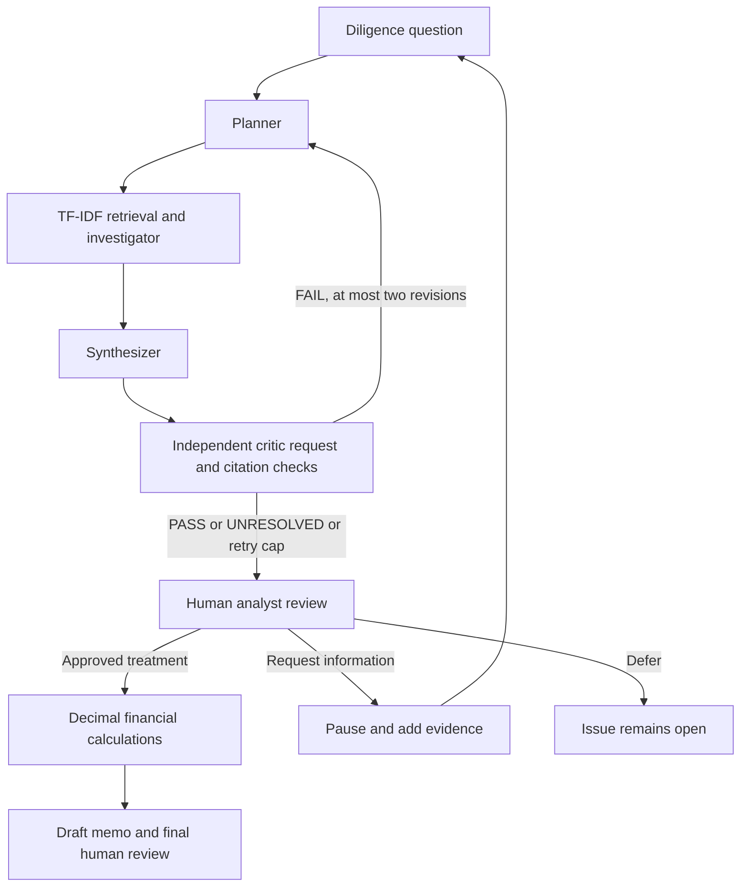

# Agentic AI for Financial Due Diligence

A local MGT 8803 prototype built around **eight original FAB documents** for the fictional Meridian Industrial Supply LLC. The interface separates investigative research, analyst judgment, and reproducible financial calculations.

## Start here (Windows PowerShell)

The project virtual environment and sample documents have already been installed in this workspace. Run:

```powershell
.\.venv\Scripts\python.exe -m streamlit run app.py
```

Open the localhost URL printed by Streamlit. Choose **Offline scripted demo**, select a case, and click **Start investigation**. Review citations, record your decision, and inspect the resulting calculation and audit export.

For a fresh setup with Python 3.11 or newer:

```powershell
python -m venv .venv
.\.venv\Scripts\python.exe -m pip install -r requirements.txt
# Only needed if the included source files are missing:
.\.venv\Scripts\python.exe scripts\fetch_fab.py
.\.venv\Scripts\python.exe -m streamlit run app.py
```

`requirements-lock.txt` records the exact dependency versions tested on Windows with Python 3.13.9. The bounded `requirements.txt` allows compatible dependency resolution for other supported Python versions.

## Three starting cases

| Case | Proposed add-back | Evidence to investigate | Reference behavior |
| --- | ---: | --- | --- |
| ERP implementation | $900,000 | Completed conversion; ongoing subscriptions and support excluded from the fee; project statement | Supported provisional recommendation; PASS to human review |
| Severance | $480,000 | Management's proposal versus personnel costs in both 2024 and 2025 | Challenged provisional recommendation; PASS to human review |
| Owner pay | $300,000 | Proposed replacement salary without an independent compensation benchmark | UNRESOLVED; request information or record an explicit analyst override |

These are questions about the source evidence, not automated accounting decisions. A PASS assesses the investigation, not whether the seller is right. The critic may FAIL an investigation with correctable defects, causing replanning and retrieval. After at most two revisions, remaining defects escalate as UNRESOLVED.

## Financial scope

The reported FY2025 EBITDA is **$21,466,000**, read from `Management_accounts_2025-12.xlsx`, `'2025-12 YTD'!B21`. Each proposed amount is read from `Earnings_schedule.xlsx`, `'Adjustments'!B5`, `B6`, or `B7`.

Each investigation isolates **one proposed adjustment**:

```text
Selected-item seller-case EBITDA = reported EBITDA + proposed add-back
Reviewed EBITDA                 = reported EBITDA + analyst-approved add-back
Enterprise value                = EBITDA × analyst-assumed multiple
Value change                    = reviewed value − selected-item seller-case value
```

For severance at 10×, rejecting the add-back leaves reviewed EBITDA at $21,466,000 and changes the selected-item enterprise-value sensitivity by −$4,800,000. Accepting the add-back produces $21,946,000. No valuation is calculated before an analyst chooses a treatment and supplies a name and rationale.

**This is not FAB's full adjusted-EBITDA or enterprise-to-equity bridge.** Freight, bonus accrual, inventory, revenue corrections, other add-backs, debt, tax, and working-capital issues remain outside this bounded calculation. The original handoff's $12 million / $2 million example was replaced with FAB's actual source figures.

## Live AI mode

Copy `.env.example` to `.env` if `.env` does not already exist. Put real keys only in `.env`, never in `.env.example`.

For **Google Gemini**, configure:

```dotenv
LLM_PROVIDER=gemini
GEMINI_API_KEY=your_key_here
GEMINI_MODEL=gemini-3.8-flash
```

The `model=` argument in Google's Python example is required. This project uses the explicitly selected `gemini-3.8-flash`. The app lets you edit the model in the sidebar and records the requested name and Google's resolved `model_version` in each agent-action audit event. A model name does not establish free-tier eligibility: check the model quotas for your project in Google AI Studio. The app does not enable paid billing or automatically switch providers/models when quota is exhausted.

Gemini uses Google's official `google-genai` SDK and [JSON-schema structured outputs](https://github.com/googleapis/python-genai#json-response-schema). The app reloads `.env` on each Streamlit run; values explicitly set there take precedence over process environment variables. Google's standalone snippet automatically reads environment variables, but Python does not load a `.env` file by itself. Gemini HTTPS connections use the operating system's certificate store, with certificate verification enabled.

For **OpenAI**, set `LLM_PROVIDER=openai`, `OPENAI_API_KEY`, and `OPENAI_MODEL`. Use an available model supporting the Responses API and [structured outputs](https://developers.openai.com/api/docs/guides/structured-outputs?api-mode=responses).

Then select **Live AI**, choose the provider and model in the sidebar, and click **Start investigation**. Source excerpts and supplemental evidence go to the selected provider. API charges or free-tier limits may apply. Credentials are not written to the audit log. Model errors stop the run; the application never silently switches to the offline demo.

The interface announces each stage before its model request begins. Gemini requests use a 60-second timeout and one HTTP attempt; the client does not hide extra provider retries. HTTP 503 indicates temporary unavailability or high demand, while HTTP 504 means the provider's deadline expired. Both can occur even for a tiny prompt before document analysis. Retry later or explicitly choose another model available to your project; restarting Streamlit does not resolve provider capacity.

- The planner selects retrieval queries and revises them from critic feedback.
- Python runs TF-IDF search over source-located passages.
- The investigator examines retrieved evidence, including potentially contradictory material.
- The synthesizer produces a provisional assessment with exact source quotes.
- The critic runs as a separate model request, with the bounded full source corpus, to check accuracy, entailment, sufficiency, periods, and missed counterevidence. It uses the same configured model, so it is not epistemically independent.
- Python verifies that cited passage IDs exist and quotes match retrieved text exactly. Exact matching does not establish that a quote supports the inference; that requires the critic and analyst.

After **Request additional information**, a live run can accept a PDF, DOCX, XLSX, TXT, or MD supplement and reinvestigate using its saved provider and model. A resumed run has a new ID linked to its parent. Previous approvals are never carried into the new run. Requests are recorded locally, not emailed to anyone. Upload contents are treated as evidence, never agent instructions. Scanned PDFs need OCR and are rejected if no text can be extracted.

The offline demo is deliberately narrower: it uses fixed source-backed rules for the three predefined questions. It cannot interpret arbitrary questions, adjudicate new documents, or demonstrate autonomous model reasoning. Its critic is scripted, and no performance improvement from criticism is claimed.

## Architecture and ownership



The first five investigation stages and conditional retry routing use a real [LangGraph StateGraph](https://docs.langchain.com/oss/python/langgraph/graph-api). The graph ends at the human-review boundary. Analyst review, upload/resume, calculations, and final review are explicit persisted service actions; this MVP does not use LangGraph interrupt/checkpoint APIs.

| Work type | Responsibility |
| --- | --- |
| Agentic, in live mode | Planning, evidence interpretation, synthesis, criticism, critic-driven revision |
| Deterministic Python | Document parsing, retrieval ranking, citation checks, source hashes, arithmetic, audit recording, memo formatting |
| Human | Approve or reject treatment, request information, choose assumptions, review the final memo |

## Evidence and audit trail

`data/fab/manifest.json` records the upstream commit, document paths, original URLs, lengths, and SHA-256 hashes. Original source files are unchanged. The app checks their hashes when loading them. Passages retain PDF page numbers, DOCX paragraph numbers, spreadsheet sheet/cell locations, or supplemental-text line numbers.

Each local `audit/<investigation-id>/` contains:

- `events.jsonl`: timestamped actions, retrieval queries and excerpts, findings, critic feedback, revisions, analyst decisions, calculation inputs/results, and final-review events.
- `state.json`: the saved run, source passages, findings, status, optional review, results, and draft memo.

Open saved runs from the sidebar or download a complete JSON export. `audit/` and `.env` are ignored by Git. These local files are inspectable and editable: this is an audit demonstration, not tamper-proof or authenticated storage. The memo is a deterministic draft assembled from research and the approved scenario; it still requires final analyst review.

## Source attribution

**FAB — Finance Agents Benchmark**, SecondState, 2026. [Upstream repository](https://github.com/SecondState-ai/finance-agents-benchmark). Data are licensed under **CC BY 4.0**; see `data/fab/LICENSE-DATA`. The source revision is recorded in `data/fab/manifest.json`. Source files are reproduced without modification; the project creates extracted representations and a smaller teaching workflow. FAB and its authors do not endorse this prototype.

No task grading criteria, published answers, or model traces are included in the agent evidence corpus. The three expected behaviors above are development references and the offline demo is scripted; it is not a blind benchmark evaluation.

Other links reviewed: [dd-vdrs](https://huggingface.co/datasets/jmzlx/dd-vdrs), [Sinabis PDFs](https://huggingface.co/datasets/sinabis-group/sinabis-10k-synthetic-pdf), [Sinabis DOCX](https://huggingface.co/datasets/sinabis-group/sinabis-100k-synthetic-docx), [ForensicBench](https://huggingface.co/datasets/WaguyMZ/ForensicBench), and [Voxel51 invoices](https://huggingface.co/datasets/Voxel51/high-quality-invoice-images-for-ocr). These are not downloaded or mixed into the company evidence. The [data-room index](https://www.securedatarooms.com/tools/data-room-index-template) and [financial checklist](https://investordatarooms.com/wp-content/uploads/2026/02/financial_due_diligence_checklist.pdf) are possible organizational references, not financial evidence for Meridian.

## Verification and limitations

```powershell
.\.venv\Scripts\python.exe -m pytest -q
```

Tests cover source-backed demo outcomes, exact citations, critic retries and limits, missing evidence, human approval, arithmetic, requests/defer behavior, and the Streamlit approve-and-finalize path. The structured live adapter and linked supplemental-document resume flow are tested with mocked model responses. Actual live-provider calls need credentials and are not exercised by the offline suite. No claim is made that the critic improves real-model accuracy without a separate controlled evaluation.

This is a local teaching application: no authentication, cloud deployment, email sending, OCR, general spreadsheet formula evaluation, or complete accounting adjudication. XLSX extraction uses cached cell values; uncached formulas require a recalculated source workbook. DOCX locations are extraction paragraph numbers, not rendered page numbers. Use the included small documents; uploads and corpus sizes are deliberately bounded.
